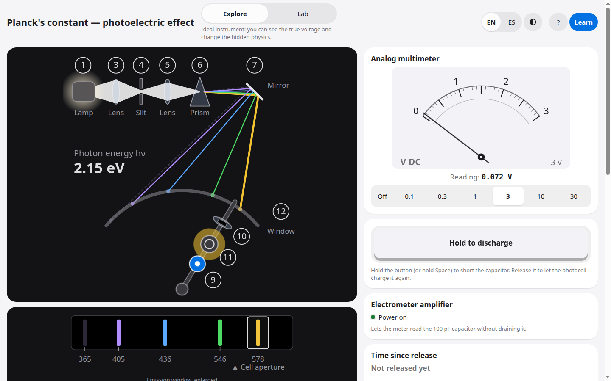
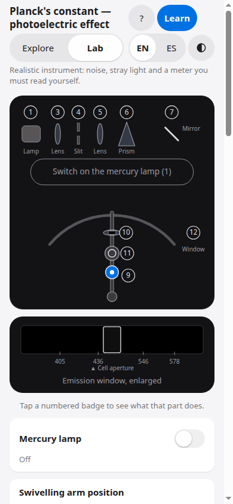
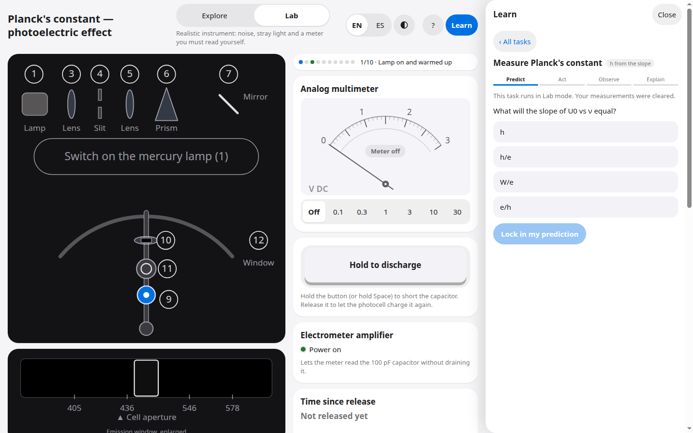
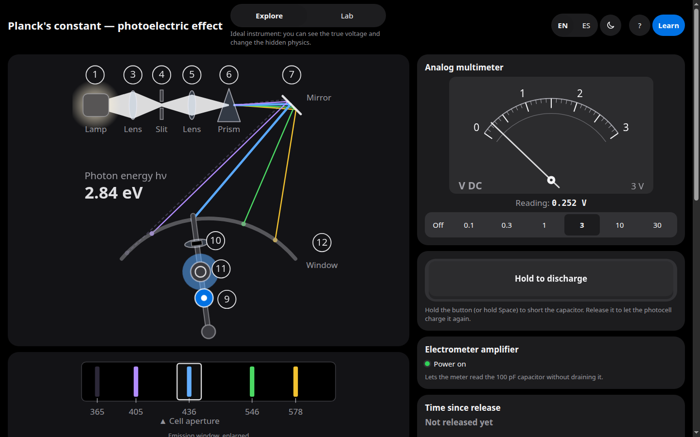

# Planck's constant: photoelectric effect (virtual lab)

A browser-based, physics-driven simulation of the compact photoelectric-effect experiment used to determine Planck's constant h: a mercury lamp, a prism, a potassium photocell, and a 100 pF capacitor that charges up to the limit voltage U0, read on an analog multimeter. Self-guided, bilingual (English and Spanish), works on phones, light and dark themes.

**Live:** https://kairi99.github.io/photoelectric-sim/



**3D bench.** The whole setup of the leaflet's Fig. 2 is modelled in 3D (three.js): choke, Hg lamp, the compact arrangement with its lenses, slit, prism and mirror, the swivelling arm with the photocell, the electrometer amplifier with capacitor and key switch, the multimeter and the cables. Students operate it directly: drag the thread-guide knob to swing the arm, hold the red key to discharge, turn the range knob, flip the lamp switch, slide the window cover. Camera presets: overview, optics, meter, top view. A 2D bench is one tap away and is used automatically when WebGL is unavailable; in 3D the 2D control panels are tucked away by default (a calm view for students) and a Show controls button opens them, with the extra Explore options; in 2D they are always shown.

## Using it in class

**Two modes** (switch at the top of the page):

- **Explore** is an ideal instrument. You see the true voltage as a digital readout, can change hidden physics (cathode material, error sources) and can run the clock at 20x. Good for building intuition and for what-if questions.
- **Lab** is a realistic bench: reading noise, leakage, stray light, and an analog needle with no number that you must read yourself. It is **honour-based**: nothing stops a student from peeking at Explore mode or typing a value; the point is practice, not policing.

**Guided tasks.** Open **Learn** and pick one of six tasks. Each follows predict, act, observe, explain, and is checked automatically against the model:

1. Find the yellow line
2. Your first U0
3. Brighter, higher U0?
4. Bright but below threshold
5. Measure Planck's constant (four lines, fit of U0 vs frequency)
6. When the bench lies (dirt, stray light)

**Also built in:** a short **tour** on the first visit (replayable from the Learn drawer), a **procedure checklist** that tracks the real steps (lamp warm, meter on, discharge, release, wait until settled, record), a **coach** that nudges when something is off (meter still off, not discharged, over range), and a bilingual **help page** (the `?` button).

**For teachers.** Add `?teacher` to the URL (for example `https://kairi99.github.io/photoelectric-sim/?teacher`) to see a teacher note and expected values in each task. The full answer key (plateau voltages, expected h, error effects) is in [`docs/teacher-key.md`](docs/teacher-key.md), generated from the model by `npm run teacher-key`.

**Accessibility.** Full keyboard operation. In Lab mode the dial reads out its needle position to screen readers, rounded to what the scale can show (for example "Needle at about 1.40 V on the 3 V range"), at most once per second.

## Screenshots

| Explore, desktop | Lab, mobile |
|---|---|
|  |  |

| Guided task | Dark theme |
|---|---|
|  |  |

## The physics model in brief

Einstein's relation e·U0 = h·ν − W: the capacitor charges until the photocurrent is stopped by the opposing voltage, so the plateau U0 grows linearly with the light frequency ν, and the slope of U0 against ν gives h/e. The model (`src/physics`) integrates the charging of the capacitor through the photocurrent (quantum yield from photon energy above threshold) against leakage, and reports the deterministic expectation; noise is a separate final step. As in the source experiment, the intercept is not the cathode work function but is set by the ring anode (contact potential).

Every empirical parameter is listed in [`PARAMETERS.md`](PARAMETERS.md) with value, unit, source or fit, and date.

**Calibration, honestly.** The Lab bench is calibrated with 4 free parameters against 4 data points, so a good match is not independent validation. The clean Lab fit gives **h ≈ 5.9·10⁻³⁴ J·s, about 11 % below the true 6.63·10⁻³⁴**. That is deliberate and realistic: leakage and stray light flatten the U0 vs ν line, as on a real bench. Explore mode with no error sources returns the true value. Tasks check h against the Lab model value, not against 6.63.

## Architecture

```
src/physics     pure, DOM-free model (SI units, no timers, no randomness)
src/apparatus   device logic: lamp, arm, cell, capacitor, meter, key, modes
src/views       bench, panel, charts, table: render state, never compute physics
src/pedagogy    tasks, checklist, coach, tour, teacher key
```

Dependencies flow downwards. Views and pedagogy read the apparatus; they never import each other's internals. UI text lives in per-view and per-language dictionaries (en default, es). `dev/` holds standalone harness pages for the bench and charts; they are not part of the build.

## Development

Node 24.

```bash
npm ci
npm run dev           # Vite dev server
npm test              # Vitest
npm run build         # tsc + vite build into dist/
npm run teacher-key   # regenerate docs/teacher-key.md from the model
```

URL parameters for deep links and screenshots: `?mode=lab`, `?lang=es`, `?theme=dark`, `?setup=lamp,meter,yellow`, `?learn=1`, `?task=planck&step=0`, `?tour=0|1`.

## Deployment

GitHub Actions (`.github/workflows`): `test.yml` runs `npm ci`, `npm test` and `npm run build` on every push and pull request. When it succeeds on `main`, `deploy.yml` builds and uploads `dist/` to GitHub Pages.

## Credits and licences

Based on LD Didactic leaflet P6.1.4.1, "Determining Planck's constant (photoelectric effect, compact arrangement)". This project is independent and **not affiliated with or endorsed by LD Didactic**. No LD material (PDFs, figures, verbatim text) is included; facts are paraphrased and the numbers are our own model's. Literature work functions are from the CRC Handbook of Chemistry and Physics.

- Code: MIT ([`LICENSE`](LICENSE))
- Educational content, docs and screenshots: CC BY 4.0 ([`LICENSE-CONTENT`](LICENSE-CONTENT))
